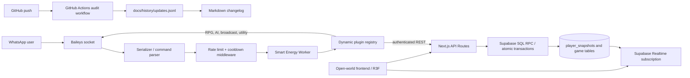

# WHISKAY RPG × WHISKAY Bot

<p align="center">
  <strong>Open-world RPG · WhatsApp automation · Smart Energy · Supabase API</strong><br/>
  <em>Modular codebases, auditable changes, mobile-first gameplay.</em>
</p>

<p align="center">
  
  
  
  
</p>

<p align="center">
  
</p>

> **Analytics note:** replace `YOUR_GITHUB_USERNAME` and `WHISKAY-RPG` with the actual public repository owner/name. The public badge counts badge views, not authoritative unique GitHub clones or GitHub's private traffic analytics.

## Project boundaries

This repository family has two independent deployables. The bot owns WhatsApp commands, energy telemetry, menus and plugin loading. The website owns the Next.js UI, 3D environment, API routes and Supabase data. They communicate through authenticated HTTP API contracts; do not merge their source trees.

## Architecture map



## Stage 14 highlights

### Web RPG
- Optional Unreal Bloom post-processing is gated behind **Graphics Quality: High**, capped to a 1.25 pixel ratio, and omitted in Low/Medium settings.
- A rare 3D Storm Wraith appears during rain at night.
- Fishing is a timing mini-game attached to a 3D lakeside spot.
- Mira has branching dialogue choices that reveal storm/fishing lore.
- Existing resource gathering, minimap, boss, day/night, and weather systems are preserved.

### WhatsApp Bot
- Energy starts at `100.00%`. Each parsed command gets a bounded decimal cost and the response footer reports consumption and remaining battery.
- Static-cost commands are marked `📌`; worker-estimated costs are marked `⚡` in detailed menus.
- `.charge` restores 40% once per 24 hours; `.charge fast` is Premium-only. Premium grants are capped at 30 days per owner action.
- `.hit`, `.profile`, `.setpayment`, `.bukti`, `.status`, and `.premium` expose usage and owner operations.
- Menu templates include `minimalist`, `cyberpunk`, and `fantasy`; menu widget switches remain per-user.
- The loader infers category from `src/plugins/<category>/` when a plugin omits its category.

## Smart Energy: why it is lightweight

The worker is deliberately **not an LLM call for every command**. A deterministic heuristic uses bounded text/token counts, math-symbol frequency, token diversity, and Jaccard similarity against at most five recent commands. Input is capped at 1,200 characters, costs are clamped to `0.25–8.75%`, and no timer or worker thread is allocated. Per-process read/modify/write operations are serialized; JSON writes use temporary files and rename. See [`docs/stage14/SMART-ENERGY-WORKER.md`](docs/stage14/SMART-ENERGY-WORKER.md).

Energy is telemetry rather than a hard usage lock: commands continue when the battery reaches zero. This avoids turning a heuristic into a hidden availability limit.

## Quick start

### Bot

```bash
cp .env.example .env
# Set OWNERS and any optional API tokens in .env
npm ci
npm test
npm start
```

Useful commands: `.menu`, `.setmenu`, `.charge`, `.charge fast`, `.hit`, `.profile`, `.status`, `.setpayment`, `.bukti`, `.premium @user 30`.

### Web RPG

```bash
npm ci
npm run verify:stage14
npm run verify:stage12-13
npm run build
npm run start
```

Build and runtime tests should be run in the target environment before deployment. This package was statically verified in the current environment; production Next.js build, real WhatsApp sends, Supabase credentials, and smartphone FPS have not been certified here.

## GitHub Flow & autonomy changelog

The workflow at `.github/workflows/repo-update-history.yml` runs on pushes to `main`/`master` and on manual dispatch. It appends a compact JSONL record with timestamp, branch, commit, actor, and the first line of the commit message to `docs/history/updates.jsonl`. The workflow uses the built-in `GITHUB_TOKEN` with `contents: write`, commits as `github-actions[bot]`, and uses `[skip ci]`/path exclusions to avoid a recursive loop.

Recommended flow:
1. Create a feature branch and update code plus tests.
2. Run bot tests and web verification/build.
3. Open a pull request and review the generated change.
4. Merge to `main`; GitHub Actions records the update metadata.
5. Periodically summarize JSONL records into a human-readable changelog.

The workflow records repository metadata; it does not autonomously execute arbitrary code or push unreviewed feature changes.

## Security & operational notes

- Never commit `.env`, service-role keys, API tokens, or payment secrets.
- `.bukti` forwards/copies proof media to configured owners; Premium activation must remain a manual verification step.
- The QRIS image path is stored locally under `data/`; use persistent storage in containers.
- `antiSpam` and `globalCooldown` switches are owner-only. Turning them off increases abuse risk.
- The 3D fishing/material prototype uses local page state; server-authoritative inventory persistence is still a separate integration task.
- The visitor badge is a third-party public service and may be blocked by clients or privacy tools.

## Documentation archive

See [`docs/README.md`](docs/README.md) for the index and the archived Markdown reports gathered from the available Stage 1–13 bot and web project files.
