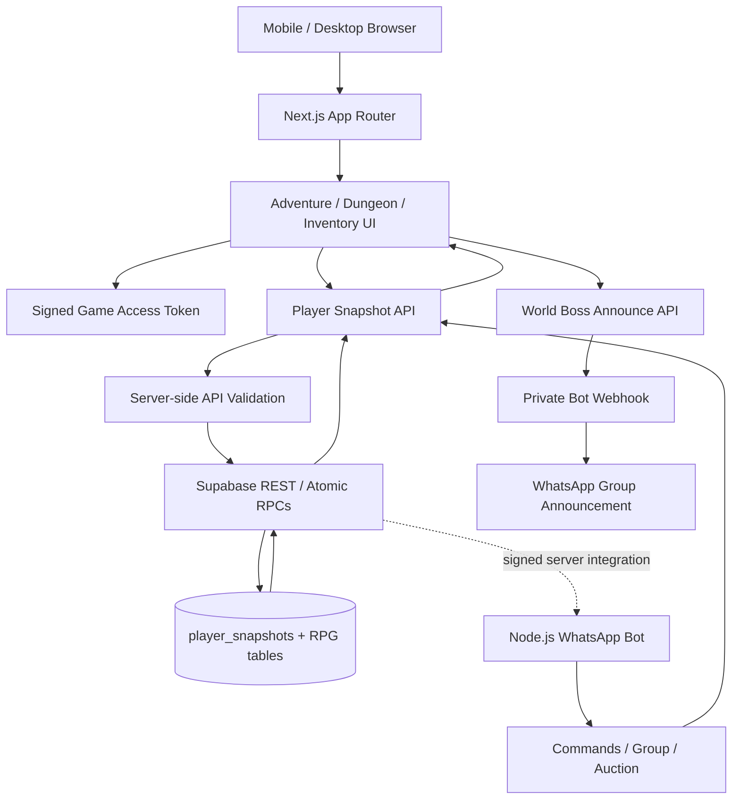

<div align="center">

# 🗡️ WHISKAY RPG COMPANION
### Aetheria · Seamless Open World · Dungeonia 1–100

   

**An independent 3D RPG web application. It is not the WhatsApp bot source tree.**

</div>

```text
      ✦ A E T H E R I A  /  FIELD CHRONICLE ✦
  Open World ── Ancient Cave ── Dungeonia: Floor 01–100
       Player Snapshot · Inventory · Guild · Auction
```

> Explore the world, discover the cave entrance, fight in the field, and continue into a multi-floor dungeon. Server-side transactions belong to Next.js API routes and Supabase; browser state is not an authoritative economy ledger.

## 🧭 World guide

| Region / system | Purpose | Route / component |
|---|---|---|
| Adventure / Aetheria | Main open-world map, NPCs, combat feedback, weather, cave entrance | `/adventure` · `components/AdventureClient.jsx` |
| Dungeonia | Dungeon floor progression, encounters and boss scaling | `/dungeon` · `components/GameClient.jsx` |
| Inventory | Character equipment and items | `/inventory` |
| Supabase snapshots | Persistent player payload | `player_snapshots` table |
| Guild | Guild create/join/kick/donate/info transactions | `/api/player/guild` + SQL RPCs |
| Global Auction | Sell and buy inventory loot with Gold | `/api/player/auction` + SQL RPCs |
| World Boss broadcast | Authenticated announcement from web to bot webhook | `/api/world-boss/announce` |

## 🧬 Architecture & synchronization



The service-role key must remain server-side. Bot requests use the shared `BOT_SYNC_TOKEN` / `DUNGEON_SYNC_TOKEN` contract; the bot itself must never receive `SUPABASE_SERVICE_ROLE_KEY`. The browser may display a snapshot, but reward/spend decisions must be performed by server-side transactions.

## 🌦️ Mounts & storm rules (Stage 18)

- **Mount recognition:** the player update event checks inventory entries for `horse`, `kuda`, `magic-wolf`, `serigala-magis`, or `serigala_magis`. When one is found, the UI displays a mount indicator and joystick movement uses a `×2` movement multiplier. This is a prototype hook; it does not yet equip a persistent mount slot or replace the full character mesh with a ride animation.
- **Storm movement debuff:** selecting `Storm` applies a 10% movement reduction to joystick input.
- **Storm attrition:** while in storm weather, the client subtracts 1 HP every 5 seconds unless the player is near the cave entrance or one of the two NPC shelter points. This is client-side prototype behavior, not a server-authoritative damage system; a production multiplayer implementation should validate HP changes server-side.
- **Inventory remains available** from the adventure header. Mount detection depends on the inventory item IDs matching the identifiers above.

## 🏛️ Global Auction House

The API route accepts bot-authenticated actions `sell`, `list`, and `buy`. The SQL migration adds `rpg_auction_listings` and `auction_sell_item`, `auction_list_items`, and `auction_buy_item` RPCs. The sell function removes one unit of the item from the seller inventory; the buy function locks the listing and player snapshots, debits buyer Gold, adds the item to buyer inventory, credits seller Gold, and marks the listing sold.

Apply the appended Stage 18 SQL to the intended Supabase project before deploying the route. This initial implementation does not include cancellation, expiry, listing fees, or a dedicated UI market board. Test transactions using disposable test accounts before production.

## 🚨 World Boss broadcast integration

When a World Boss component mounts, the web client signals `/api/world-boss/announce` at most once per minute. The API verifies the current player's signed game access token, then forwards a fixed `world_boss_spawned` event to `WHISKAY_BOT_WEBHOOK_URL` using a server-only shared secret. The bot then broadcasts the fixed Indonesian announcement to groups it participates in. Configure both services and secure the bot webhook with HTTPS / firewall rules. If the bot is not reachable from the internet, this integration cannot work until a secured relay or public endpoint is provided.

## 🛠️ Configure & run

```bash
cp .env.example .env.local
npm ci
npm run dev
```

Production build and regression checks:

```bash
npm run verify:routes
npm run verify:stage17
npm run verify:stage18
npm run build
```

Required server-only variables: `SUPABASE_URL`, `SUPABASE_SERVICE_ROLE_KEY`, `BOT_SYNC_TOKEN` (or `DUNGEON_SYNC_TOKEN`), `WHISKAY_BOT_WEBHOOK_URL`, and `WHISKAY_BOSS_WEBHOOK_SECRET`. Never prefix secrets with `NEXT_PUBLIC_`.

## 🔐 Access, persistence & limitations

- Dungeon entry and protected pages rely on signed short-lived access tokens; tokens should be issued by the bot and validated on every protected mutation.
- The snapshot update route currently merges allow-listed fields but is not a universal atomic economy engine. Keep Gold/XP/loot rewards behind SQL RPCs to avoid race conditions and client tampering.
- Some combat, movement, weather damage, and mount behavior remain client-side prototype effects. They can be modified by a user controlling their browser.
- A successful static verifier does not prove live Supabase connectivity, webhook delivery, mobile frame rate, or a complete Next.js production build.
- The website and bot must be deployed separately. Do not merge their source trees or copy server secrets between environments.

## Stage 19 compatibility note

The Stage 19 changes target the separate WhatsApp bot. Website runtime code is unchanged in this stage; see [Stage 19 audit](docs/STAGE-19-AUDIT.md) for integration boundaries.

## 📚 Documentation & Archives

The table below lists Markdown documentation present in this repository; paths are relative and GitHub-compatible.

| Dokumen | Path |
|---|---|
| [Documentation index](docs/README.md) | `docs/README.md` |
| [Stage 16 — Guild, Combat Feedback & Equipment](docs/STAGE-16-COMBAT-GUILD.md) | `docs/STAGE-16-COMBAT-GUILD.md` |
| [Stage 17 — Web RPG audit](docs/STAGE-17-AUDIT.md) | `docs/STAGE-17-AUDIT.md` |
| [Stage 18 — RPG implementation & audit](docs/STAGE-18-AUDIT.md) | `docs/STAGE-18-AUDIT.md` |
| [WhiskayBot Menu Update](docs/archive/bot/README-MENU-UPDATE.md) | `docs/archive/bot/README-MENU-UPDATE.md` |
| [WhiskayBot — Menu, Profile & Dungeon Upgrade](docs/archive/bot/README-REWORK.md) | `docs/archive/bot/README-REWORK.md` |
| [WhiskayBot v2.3.4 — Profile/Menu Image + Scrape](docs/archive/bot/README-UPDATE-2.3.4.md) | `docs/archive/bot/README-UPDATE-2.3.4.md` |
| [WhiskayBot v2.3.5 — YouTube tools](docs/archive/bot/README-YOUTUBE-2.3.5.md) | `docs/archive/bot/README-YOUTUBE-2.3.5.md` |
| [WHISKAYBOT](docs/archive/bot/ROOT-README.md) | `docs/archive/bot/ROOT-README.md` |
| [Stage 9 — RPG Economy (Bot)](docs/archive/bot/STAGE-9-ECONOMY.md) | `docs/archive/bot/STAGE-9-ECONOMY.md` |
| [Operational history, audit, and visitor analytics](docs/archive/bot/docs/ANALYTICS-AND-AUDIT.md) | `docs/archive/bot/docs/ANALYTICS-AND-AUDIT.md` |
| [Razzaq Ventures Website Integration](docs/archive/bot/docs/RAZZAQ-WEBSITE-INTEGRATION.md) | `docs/archive/bot/docs/RAZZAQ-WEBSITE-INTEGRATION.md` |
| [WhiskayBot Menu Update](docs/archive/bot/docs/README-MENU-UPDATE.md) | `docs/archive/bot/docs/README-MENU-UPDATE.md` |
| [WhiskayBot v2.3.4 — Profile/Menu Image + Scrape](docs/archive/bot/docs/README-UPDATE-2.3.4.md) | `docs/archive/bot/docs/README-UPDATE-2.3.4.md` |
| [WhiskayBot v2.3.5 — YouTube tools](docs/archive/bot/docs/README-YOUTUBE-2.3.5.md) | `docs/archive/bot/docs/README-YOUTUBE-2.3.5.md` |
| [WhiskayBot v2.3.6 — Documentation, RPG, Ping and Repository Audit](docs/archive/bot/docs/RELEASE-2.3.6.md) | `docs/archive/bot/docs/RELEASE-2.3.6.md` |
| [WhiskayBot v2.3.7 — YouTube Preview & Profile Canvas](docs/archive/bot/docs/RELEASE-2.3.7.md) | `docs/archive/bot/docs/RELEASE-2.3.7.md` |
| [WhiskayBot v2.3.8](docs/archive/bot/docs/RELEASE-2.3.8.md) | `docs/archive/bot/docs/RELEASE-2.3.8.md` |
| [WhiskayBot v2.3.9](docs/archive/bot/docs/RELEASE-2.3.9.md) | `docs/archive/bot/docs/RELEASE-2.3.9.md` |
| [WhiskayBot 2.4.0 — RPG Gacha and shared inventory metadata](docs/archive/bot/docs/RELEASE-2.4.0-RPG-GACHA.md) | `docs/archive/bot/docs/RELEASE-2.4.0-RPG-GACHA.md` |
| [Stage 7 — Interactive downloader](docs/archive/bot/docs/STAGE-7-DOWNLOADER.md) | `docs/archive/bot/docs/STAGE-7-DOWNLOADER.md` |
| [Stage 9 — RPG Economy](docs/archive/bot/docs/STAGE-9-ECONOMY.md) | `docs/archive/bot/docs/STAGE-9-ECONOMY.md` |
| [Source update history](docs/archive/bot/docs/history/README.md) | `docs/archive/bot/docs/history/README.md` |
| [WhiskayBot Menu Update](docs/archive/complete-bot/docs/archive/bot/README-MENU-UPDATE.md) | `docs/archive/complete-bot/docs/archive/bot/README-MENU-UPDATE.md` |
| [WhiskayBot — Menu, Profile & Dungeon Upgrade](docs/archive/complete-bot/docs/archive/bot/README-REWORK.md) | `docs/archive/complete-bot/docs/archive/bot/README-REWORK.md` |
| [WhiskayBot v2.3.4 — Profile/Menu Image + Scrape](docs/archive/complete-bot/docs/archive/bot/README-UPDATE-2.3.4.md) | `docs/archive/complete-bot/docs/archive/bot/README-UPDATE-2.3.4.md` |
| [WhiskayBot v2.3.5 — YouTube tools](docs/archive/complete-bot/docs/archive/bot/README-YOUTUBE-2.3.5.md) | `docs/archive/complete-bot/docs/archive/bot/README-YOUTUBE-2.3.5.md` |
| [WHISKAYBOT](docs/archive/complete-bot/docs/archive/bot/ROOT-README.md) | `docs/archive/complete-bot/docs/archive/bot/ROOT-README.md` |
| [Stage 9 — RPG Economy (Bot)](docs/archive/complete-bot/docs/archive/bot/STAGE-9-ECONOMY.md) | `docs/archive/complete-bot/docs/archive/bot/STAGE-9-ECONOMY.md` |
| [Operational history, audit, and visitor analytics](docs/archive/complete-bot/docs/archive/bot/docs/ANALYTICS-AND-AUDIT.md) | `docs/archive/complete-bot/docs/archive/bot/docs/ANALYTICS-AND-AUDIT.md` |
| [Razzaq Ventures Website Integration](docs/archive/complete-bot/docs/archive/bot/docs/RAZZAQ-WEBSITE-INTEGRATION.md) | `docs/archive/complete-bot/docs/archive/bot/docs/RAZZAQ-WEBSITE-INTEGRATION.md` |
| [WhiskayBot Menu Update](docs/archive/complete-bot/docs/archive/bot/docs/README-MENU-UPDATE.md) | `docs/archive/complete-bot/docs/archive/bot/docs/README-MENU-UPDATE.md` |
| [WhiskayBot v2.3.4 — Profile/Menu Image + Scrape](docs/archive/complete-bot/docs/archive/bot/docs/README-UPDATE-2.3.4.md) | `docs/archive/complete-bot/docs/archive/bot/docs/README-UPDATE-2.3.4.md` |
| [WhiskayBot v2.3.5 — YouTube tools](docs/archive/complete-bot/docs/archive/bot/docs/README-YOUTUBE-2.3.5.md) | `docs/archive/complete-bot/docs/archive/bot/docs/README-YOUTUBE-2.3.5.md` |
| [WhiskayBot v2.3.6 — Documentation, RPG, Ping and Repository Audit](docs/archive/complete-bot/docs/archive/bot/docs/RELEASE-2.3.6.md) | `docs/archive/complete-bot/docs/archive/bot/docs/RELEASE-2.3.6.md` |
| [WhiskayBot v2.3.7 — YouTube Preview & Profile Canvas](docs/archive/complete-bot/docs/archive/bot/docs/RELEASE-2.3.7.md) | `docs/archive/complete-bot/docs/archive/bot/docs/RELEASE-2.3.7.md` |
| [WhiskayBot v2.3.8](docs/archive/complete-bot/docs/archive/bot/docs/RELEASE-2.3.8.md) | `docs/archive/complete-bot/docs/archive/bot/docs/RELEASE-2.3.8.md` |
| [WhiskayBot v2.3.9](docs/archive/complete-bot/docs/archive/bot/docs/RELEASE-2.3.9.md) | `docs/archive/complete-bot/docs/archive/bot/docs/RELEASE-2.3.9.md` |
| [WhiskayBot 2.4.0 — RPG Gacha and shared inventory metadata](docs/archive/complete-bot/docs/archive/bot/docs/RELEASE-2.4.0-RPG-GACHA.md) | `docs/archive/complete-bot/docs/archive/bot/docs/RELEASE-2.4.0-RPG-GACHA.md` |
| [Stage 7 — Interactive downloader](docs/archive/complete-bot/docs/archive/bot/docs/STAGE-7-DOWNLOADER.md) | `docs/archive/complete-bot/docs/archive/bot/docs/STAGE-7-DOWNLOADER.md` |
| [Stage 9 — RPG Economy](docs/archive/complete-bot/docs/archive/bot/docs/STAGE-9-ECONOMY.md) | `docs/archive/complete-bot/docs/archive/bot/docs/STAGE-9-ECONOMY.md` |
| [Source update history](docs/archive/complete-bot/docs/archive/bot/docs/history/README.md) | `docs/archive/complete-bot/docs/archive/bot/docs/history/README.md` |
| [Changelog — Whiskay RPG Next.js update](docs/archive/complete-bot/docs/archive/web/CHANGELOG.md) | `docs/archive/complete-bot/docs/archive/web/CHANGELOG.md` |
| [WHISKAY RPG Open World Action Update v2](docs/archive/complete-bot/docs/archive/web/OPEN-WORLD-ACTION-UPDATE-V2.md) | `docs/archive/complete-bot/docs/archive/web/OPEN-WORLD-ACTION-UPDATE-V2.md` |
| [WHISKAY RPG — Open World Action Update](docs/archive/complete-bot/docs/archive/web/OPEN-WORLD-ACTION-UPDATE.md) | `docs/archive/complete-bot/docs/archive/web/OPEN-WORLD-ACTION-UPDATE.md` |
| [Whiskay RPG — Next.js 3D Arena Scaffold](docs/archive/complete-bot/docs/archive/web/ROOT-README.md) | `docs/archive/complete-bot/docs/archive/web/ROOT-README.md` |
| [Whiskay RPG — Seed, Template & Spirit Sheet](docs/archive/complete-bot/docs/archive/web/SEED-TEMPLATE-SPIRIT-SHEET.md) | `docs/archive/complete-bot/docs/archive/web/SEED-TEMPLATE-SPIRIT-SHEET.md` |
| [Stage 1 — Story Lore UI & Dungeon Mechanics](docs/archive/complete-bot/docs/archive/web/STAGE-1-LORE-DUNGEON.md) | `docs/archive/complete-bot/docs/archive/web/STAGE-1-LORE-DUNGEON.md` |
| [Stage 11 — World Environment](docs/archive/complete-bot/docs/archive/web/STAGE-11-SETUP.md) | `docs/archive/complete-bot/docs/archive/web/STAGE-11-SETUP.md` |
| [WHISKAY RPG — Stage 12–13](docs/archive/complete-bot/docs/archive/web/STAGE-12-13-SETUP.md) | `docs/archive/complete-bot/docs/archive/web/STAGE-12-13-SETUP.md` |
| [Stage 2 — Player Snapshot API (Corrected)](docs/archive/complete-bot/docs/archive/web/STAGE-2-PLAYER-SYNC-API.md) | `docs/archive/complete-bot/docs/archive/web/STAGE-2-PLAYER-SYNC-API.md` |
| [Stage 4 — Quick Use Potion + Floor 5 Elite Boss](docs/archive/complete-bot/docs/archive/web/STAGE-4-BOSS-QUICK-USE.md) | `docs/archive/complete-bot/docs/archive/web/STAGE-4-BOSS-QUICK-USE.md` |
| [WHISKAY RPG — Tahap 5 & 6](docs/archive/complete-bot/docs/archive/web/STAGE-5-6-SETUP.md) | `docs/archive/complete-bot/docs/archive/web/STAGE-5-6-SETUP.md` |
| [WHISKAY RPG — Stage 9 & 10](docs/archive/complete-bot/docs/archive/web/STAGE-9-10-SETUP.md) | `docs/archive/complete-bot/docs/archive/web/STAGE-9-10-SETUP.md` |
| [Perbaikan deployment Vercel](docs/archive/complete-bot/docs/archive/web/VERCEL-DEPLOY-FIX.md) | `docs/archive/complete-bot/docs/archive/web/VERCEL-DEPLOY-FIX.md` |
| [Source update history](docs/archive/complete-bot/docs/history/README.md) | `docs/archive/complete-bot/docs/history/README.md` |
| [Tahap 14 — Implementation & Verification Report](docs/archive/complete-bot/docs/stage14/IMPLEMENTATION-REPORT.md) | `docs/archive/complete-bot/docs/stage14/IMPLEMENTATION-REPORT.md` |
| [Smart Energy Worker — Tahap 14](docs/archive/complete-bot/docs/stage14/SMART-ENERGY-WORKER.md) | `docs/archive/complete-bot/docs/stage14/SMART-ENERGY-WORKER.md` |
| [Tahap 14 — Setup dan verifikasi](docs/archive/complete-bot/docs/stage14/STAGE-14-SETUP.md) | `docs/archive/complete-bot/docs/stage14/STAGE-14-SETUP.md` |
| [WhiskayBot Menu Update](docs/archive/complete-bot/docs/stages/README-MENU-UPDATE.md) | `docs/archive/complete-bot/docs/stages/README-MENU-UPDATE.md` |
| [WhiskayBot — Menu, Profile & Dungeon Upgrade](docs/archive/complete-bot/docs/stages/README-REWORK.md) | `docs/archive/complete-bot/docs/stages/README-REWORK.md` |
| [WhiskayBot v2.3.4 — Profile/Menu Image + Scrape](docs/archive/complete-bot/docs/stages/README-UPDATE-2.3.4.md) | `docs/archive/complete-bot/docs/stages/README-UPDATE-2.3.4.md` |
| [WhiskayBot v2.3.5 — YouTube tools](docs/archive/complete-bot/docs/stages/README-YOUTUBE-2.3.5.md) | `docs/archive/complete-bot/docs/stages/README-YOUTUBE-2.3.5.md` |
| [Stage 9 — RPG Economy (Bot)](docs/archive/complete-bot/docs/stages/STAGE-9-ECONOMY.md) | `docs/archive/complete-bot/docs/stages/STAGE-9-ECONOMY.md` |
| [WhiskayBot Menu Update](docs/archive/complete-web/docs/archive/bot/README-MENU-UPDATE.md) | `docs/archive/complete-web/docs/archive/bot/README-MENU-UPDATE.md` |
| [WhiskayBot — Menu, Profile & Dungeon Upgrade](docs/archive/complete-web/docs/archive/bot/README-REWORK.md) | `docs/archive/complete-web/docs/archive/bot/README-REWORK.md` |
| [WhiskayBot v2.3.4 — Profile/Menu Image + Scrape](docs/archive/complete-web/docs/archive/bot/README-UPDATE-2.3.4.md) | `docs/archive/complete-web/docs/archive/bot/README-UPDATE-2.3.4.md` |
| [WhiskayBot v2.3.5 — YouTube tools](docs/archive/complete-web/docs/archive/bot/README-YOUTUBE-2.3.5.md) | `docs/archive/complete-web/docs/archive/bot/README-YOUTUBE-2.3.5.md` |
| [WHISKAYBOT](docs/archive/complete-web/docs/archive/bot/ROOT-README.md) | `docs/archive/complete-web/docs/archive/bot/ROOT-README.md` |
| [Stage 9 — RPG Economy (Bot)](docs/archive/complete-web/docs/archive/bot/STAGE-9-ECONOMY.md) | `docs/archive/complete-web/docs/archive/bot/STAGE-9-ECONOMY.md` |
| [Operational history, audit, and visitor analytics](docs/archive/complete-web/docs/archive/bot/docs/ANALYTICS-AND-AUDIT.md) | `docs/archive/complete-web/docs/archive/bot/docs/ANALYTICS-AND-AUDIT.md` |
| [Razzaq Ventures Website Integration](docs/archive/complete-web/docs/archive/bot/docs/RAZZAQ-WEBSITE-INTEGRATION.md) | `docs/archive/complete-web/docs/archive/bot/docs/RAZZAQ-WEBSITE-INTEGRATION.md` |
| [WhiskayBot Menu Update](docs/archive/complete-web/docs/archive/bot/docs/README-MENU-UPDATE.md) | `docs/archive/complete-web/docs/archive/bot/docs/README-MENU-UPDATE.md` |
| [WhiskayBot v2.3.4 — Profile/Menu Image + Scrape](docs/archive/complete-web/docs/archive/bot/docs/README-UPDATE-2.3.4.md) | `docs/archive/complete-web/docs/archive/bot/docs/README-UPDATE-2.3.4.md` |
| [WhiskayBot v2.3.5 — YouTube tools](docs/archive/complete-web/docs/archive/bot/docs/README-YOUTUBE-2.3.5.md) | `docs/archive/complete-web/docs/archive/bot/docs/README-YOUTUBE-2.3.5.md` |
| [WhiskayBot v2.3.6 — Documentation, RPG, Ping and Repository Audit](docs/archive/complete-web/docs/archive/bot/docs/RELEASE-2.3.6.md) | `docs/archive/complete-web/docs/archive/bot/docs/RELEASE-2.3.6.md` |
| [WhiskayBot v2.3.7 — YouTube Preview & Profile Canvas](docs/archive/complete-web/docs/archive/bot/docs/RELEASE-2.3.7.md) | `docs/archive/complete-web/docs/archive/bot/docs/RELEASE-2.3.7.md` |
| [WhiskayBot v2.3.8](docs/archive/complete-web/docs/archive/bot/docs/RELEASE-2.3.8.md) | `docs/archive/complete-web/docs/archive/bot/docs/RELEASE-2.3.8.md` |
| [WhiskayBot v2.3.9](docs/archive/complete-web/docs/archive/bot/docs/RELEASE-2.3.9.md) | `docs/archive/complete-web/docs/archive/bot/docs/RELEASE-2.3.9.md` |
| [WhiskayBot 2.4.0 — RPG Gacha and shared inventory metadata](docs/archive/complete-web/docs/archive/bot/docs/RELEASE-2.4.0-RPG-GACHA.md) | `docs/archive/complete-web/docs/archive/bot/docs/RELEASE-2.4.0-RPG-GACHA.md` |
| [Stage 7 — Interactive downloader](docs/archive/complete-web/docs/archive/bot/docs/STAGE-7-DOWNLOADER.md) | `docs/archive/complete-web/docs/archive/bot/docs/STAGE-7-DOWNLOADER.md` |
| [Stage 9 — RPG Economy](docs/archive/complete-web/docs/archive/bot/docs/STAGE-9-ECONOMY.md) | `docs/archive/complete-web/docs/archive/bot/docs/STAGE-9-ECONOMY.md` |
| [Source update history](docs/archive/complete-web/docs/archive/bot/docs/history/README.md) | `docs/archive/complete-web/docs/archive/bot/docs/history/README.md` |
| [Changelog — Whiskay RPG Next.js update](docs/archive/complete-web/docs/archive/web/CHANGELOG.md) | `docs/archive/complete-web/docs/archive/web/CHANGELOG.md` |
| [WHISKAY RPG Open World Action Update v2](docs/archive/complete-web/docs/archive/web/OPEN-WORLD-ACTION-UPDATE-V2.md) | `docs/archive/complete-web/docs/archive/web/OPEN-WORLD-ACTION-UPDATE-V2.md` |
| [WHISKAY RPG — Open World Action Update](docs/archive/complete-web/docs/archive/web/OPEN-WORLD-ACTION-UPDATE.md) | `docs/archive/complete-web/docs/archive/web/OPEN-WORLD-ACTION-UPDATE.md` |
| [Whiskay RPG — Next.js 3D Arena Scaffold](docs/archive/complete-web/docs/archive/web/ROOT-README.md) | `docs/archive/complete-web/docs/archive/web/ROOT-README.md` |
| [Whiskay RPG — Seed, Template & Spirit Sheet](docs/archive/complete-web/docs/archive/web/SEED-TEMPLATE-SPIRIT-SHEET.md) | `docs/archive/complete-web/docs/archive/web/SEED-TEMPLATE-SPIRIT-SHEET.md` |
| [Stage 1 — Story Lore UI & Dungeon Mechanics](docs/archive/complete-web/docs/archive/web/STAGE-1-LORE-DUNGEON.md) | `docs/archive/complete-web/docs/archive/web/STAGE-1-LORE-DUNGEON.md` |
| [Stage 11 — World Environment](docs/archive/complete-web/docs/archive/web/STAGE-11-SETUP.md) | `docs/archive/complete-web/docs/archive/web/STAGE-11-SETUP.md` |
| [WHISKAY RPG — Stage 12–13](docs/archive/complete-web/docs/archive/web/STAGE-12-13-SETUP.md) | `docs/archive/complete-web/docs/archive/web/STAGE-12-13-SETUP.md` |
| [Stage 2 — Player Snapshot API (Corrected)](docs/archive/complete-web/docs/archive/web/STAGE-2-PLAYER-SYNC-API.md) | `docs/archive/complete-web/docs/archive/web/STAGE-2-PLAYER-SYNC-API.md` |
| [Stage 4 — Quick Use Potion + Floor 5 Elite Boss](docs/archive/complete-web/docs/archive/web/STAGE-4-BOSS-QUICK-USE.md) | `docs/archive/complete-web/docs/archive/web/STAGE-4-BOSS-QUICK-USE.md` |
| [WHISKAY RPG — Tahap 5 & 6](docs/archive/complete-web/docs/archive/web/STAGE-5-6-SETUP.md) | `docs/archive/complete-web/docs/archive/web/STAGE-5-6-SETUP.md` |
| [WHISKAY RPG — Stage 9 & 10](docs/archive/complete-web/docs/archive/web/STAGE-9-10-SETUP.md) | `docs/archive/complete-web/docs/archive/web/STAGE-9-10-SETUP.md` |
| [Perbaikan deployment Vercel](docs/archive/complete-web/docs/archive/web/VERCEL-DEPLOY-FIX.md) | `docs/archive/complete-web/docs/archive/web/VERCEL-DEPLOY-FIX.md` |
| [Source update history](docs/archive/complete-web/docs/history/README.md) | `docs/archive/complete-web/docs/history/README.md` |
| [Tahap 14 — Implementation & Verification Report](docs/archive/complete-web/docs/stage14/IMPLEMENTATION-REPORT.md) | `docs/archive/complete-web/docs/stage14/IMPLEMENTATION-REPORT.md` |
| [Smart Energy Worker — Tahap 14](docs/archive/complete-web/docs/stage14/SMART-ENERGY-WORKER.md) | `docs/archive/complete-web/docs/stage14/SMART-ENERGY-WORKER.md` |
| [Tahap 14 — Setup dan verifikasi](docs/archive/complete-web/docs/stage14/STAGE-14-SETUP.md) | `docs/archive/complete-web/docs/stage14/STAGE-14-SETUP.md` |
| [Changelog — Whiskay RPG Next.js update](docs/archive/complete-web/docs/stages/CHANGELOG.md) | `docs/archive/complete-web/docs/stages/CHANGELOG.md` |
| [WHISKAY RPG Open World Action Update v2](docs/archive/complete-web/docs/stages/OPEN-WORLD-ACTION-UPDATE-V2.md) | `docs/archive/complete-web/docs/stages/OPEN-WORLD-ACTION-UPDATE-V2.md` |
| [WHISKAY RPG — Open World Action Update](docs/archive/complete-web/docs/stages/OPEN-WORLD-ACTION-UPDATE.md) | `docs/archive/complete-web/docs/stages/OPEN-WORLD-ACTION-UPDATE.md` |
| [Whiskay RPG — Seed, Template & Spirit Sheet](docs/archive/complete-web/docs/stages/SEED-TEMPLATE-SPIRIT-SHEET.md) | `docs/archive/complete-web/docs/stages/SEED-TEMPLATE-SPIRIT-SHEET.md` |
| [Stage 1 — Story Lore UI & Dungeon Mechanics](docs/archive/complete-web/docs/stages/STAGE-1-LORE-DUNGEON.md) | `docs/archive/complete-web/docs/stages/STAGE-1-LORE-DUNGEON.md` |
| [Stage 11 — World Environment](docs/archive/complete-web/docs/stages/STAGE-11-SETUP.md) | `docs/archive/complete-web/docs/stages/STAGE-11-SETUP.md` |
| [WHISKAY RPG — Stage 12–13](docs/archive/complete-web/docs/stages/STAGE-12-13-SETUP.md) | `docs/archive/complete-web/docs/stages/STAGE-12-13-SETUP.md` |
| [Stage 2 — Player Snapshot API (Corrected)](docs/archive/complete-web/docs/stages/STAGE-2-PLAYER-SYNC-API.md) | `docs/archive/complete-web/docs/stages/STAGE-2-PLAYER-SYNC-API.md` |
| [Stage 4 — Quick Use Potion + Floor 5 Elite Boss](docs/archive/complete-web/docs/stages/STAGE-4-BOSS-QUICK-USE.md) | `docs/archive/complete-web/docs/stages/STAGE-4-BOSS-QUICK-USE.md` |
| [WHISKAY RPG — Tahap 5 & 6](docs/archive/complete-web/docs/stages/STAGE-5-6-SETUP.md) | `docs/archive/complete-web/docs/stages/STAGE-5-6-SETUP.md` |
| [WHISKAY RPG — Stage 9 & 10](docs/archive/complete-web/docs/stages/STAGE-9-10-SETUP.md) | `docs/archive/complete-web/docs/stages/STAGE-9-10-SETUP.md` |
| [Perbaikan deployment Vercel](docs/archive/complete-web/docs/stages/VERCEL-DEPLOY-FIX.md) | `docs/archive/complete-web/docs/stages/VERCEL-DEPLOY-FIX.md` |
| [Changelog — Whiskay RPG Next.js update](docs/archive/web/CHANGELOG.md) | `docs/archive/web/CHANGELOG.md` |
| [WHISKAY RPG Open World Action Update v2](docs/archive/web/OPEN-WORLD-ACTION-UPDATE-V2.md) | `docs/archive/web/OPEN-WORLD-ACTION-UPDATE-V2.md` |
| [WHISKAY RPG — Open World Action Update](docs/archive/web/OPEN-WORLD-ACTION-UPDATE.md) | `docs/archive/web/OPEN-WORLD-ACTION-UPDATE.md` |
| [Whiskay RPG — Next.js 3D Arena Scaffold](docs/archive/web/ROOT-README.md) | `docs/archive/web/ROOT-README.md` |
| [Whiskay RPG — Seed, Template & Spirit Sheet](docs/archive/web/SEED-TEMPLATE-SPIRIT-SHEET.md) | `docs/archive/web/SEED-TEMPLATE-SPIRIT-SHEET.md` |
| [Stage 1 — Story Lore UI & Dungeon Mechanics](docs/archive/web/STAGE-1-LORE-DUNGEON.md) | `docs/archive/web/STAGE-1-LORE-DUNGEON.md` |
| [Stage 11 — World Environment](docs/archive/web/STAGE-11-SETUP.md) | `docs/archive/web/STAGE-11-SETUP.md` |
| [WHISKAY RPG — Stage 12–13](docs/archive/web/STAGE-12-13-SETUP.md) | `docs/archive/web/STAGE-12-13-SETUP.md` |
| [Stage 2 — Player Snapshot API (Corrected)](docs/archive/web/STAGE-2-PLAYER-SYNC-API.md) | `docs/archive/web/STAGE-2-PLAYER-SYNC-API.md` |
| [Stage 4 — Quick Use Potion + Floor 5 Elite Boss](docs/archive/web/STAGE-4-BOSS-QUICK-USE.md) | `docs/archive/web/STAGE-4-BOSS-QUICK-USE.md` |
| [WHISKAY RPG — Tahap 5 & 6](docs/archive/web/STAGE-5-6-SETUP.md) | `docs/archive/web/STAGE-5-6-SETUP.md` |
| [WHISKAY RPG — Stage 9 & 10](docs/archive/web/STAGE-9-10-SETUP.md) | `docs/archive/web/STAGE-9-10-SETUP.md` |
| [Perbaikan deployment Vercel](docs/archive/web/VERCEL-DEPLOY-FIX.md) | `docs/archive/web/VERCEL-DEPLOY-FIX.md` |
| [Source update history](docs/history/README.md) | `docs/history/README.md` |
| [Tahap 14 — Implementation & Verification Report](docs/stage14/IMPLEMENTATION-REPORT.md) | `docs/stage14/IMPLEMENTATION-REPORT.md` |
| [Smart Energy Worker — Tahap 14](docs/stage14/SMART-ENERGY-WORKER.md) | `docs/stage14/SMART-ENERGY-WORKER.md` |
| [Tahap 14 — Setup dan verifikasi](docs/stage14/STAGE-14-SETUP.md) | `docs/stage14/STAGE-14-SETUP.md` |
| [Stage 15 Implementation Report](docs/stage15/IMPLEMENTATION-REPORT.md) | `docs/stage15/IMPLEMENTATION-REPORT.md` |
| [Stage 15 Setup](docs/stage15/SETUP.md) | `docs/stage15/SETUP.md` |
| [Changelog — Whiskay RPG Next.js update](docs/stages/CHANGELOG.md) | `docs/stages/CHANGELOG.md` |
| [WHISKAY RPG Open World Action Update v2](docs/stages/OPEN-WORLD-ACTION-UPDATE-V2.md) | `docs/stages/OPEN-WORLD-ACTION-UPDATE-V2.md` |
| [WHISKAY RPG — Open World Action Update](docs/stages/OPEN-WORLD-ACTION-UPDATE.md) | `docs/stages/OPEN-WORLD-ACTION-UPDATE.md` |
| [Whiskay RPG — Seed, Template & Spirit Sheet](docs/stages/SEED-TEMPLATE-SPIRIT-SHEET.md) | `docs/stages/SEED-TEMPLATE-SPIRIT-SHEET.md` |
| [Stage 1 — Story Lore UI & Dungeon Mechanics](docs/stages/STAGE-1-LORE-DUNGEON.md) | `docs/stages/STAGE-1-LORE-DUNGEON.md` |
| [Stage 11 — World Environment](docs/stages/STAGE-11-SETUP.md) | `docs/stages/STAGE-11-SETUP.md` |
| [WHISKAY RPG — Stage 12–13](docs/stages/STAGE-12-13-SETUP.md) | `docs/stages/STAGE-12-13-SETUP.md` |
| [Stage 2 — Player Snapshot API (Corrected)](docs/stages/STAGE-2-PLAYER-SYNC-API.md) | `docs/stages/STAGE-2-PLAYER-SYNC-API.md` |
| [Stage 4 — Quick Use Potion + Floor 5 Elite Boss](docs/stages/STAGE-4-BOSS-QUICK-USE.md) | `docs/stages/STAGE-4-BOSS-QUICK-USE.md` |
| [WHISKAY RPG — Tahap 5 & 6](docs/stages/STAGE-5-6-SETUP.md) | `docs/stages/STAGE-5-6-SETUP.md` |
| [WHISKAY RPG — Stage 9 & 10](docs/stages/STAGE-9-10-SETUP.md) | `docs/stages/STAGE-9-10-SETUP.md` |
| [Perbaikan deployment Vercel](docs/stages/VERCEL-DEPLOY-FIX.md) | `docs/stages/VERCEL-DEPLOY-FIX.md` |
---

<div align="center">

**WHISKAY RPG · The world is open. Your story is yours.**

</div>


## Stage 20 — 3D Virtual Companion
- `components/VirtualPet.jsx` renders an animated 3D follower; `PetManagementOverlay.jsx` shows its saved hunger/energy stats.
- Spirit Seed and Night Wisp only spawn at in-game night (19:00–05:59).
- `POST /api/player/pet` provides `hatch`, `feed`, and `status` actions, validates the bot token, persists to `player_snapshots`, and consumes pet food from inventory.
- Configure `BOT_SYNC_TOKEN` (or `DUNGEON_SYNC_TOKEN`) and `SUPABASE_URL` / `SUPABASE_SERVICE_ROLE_KEY` server-side. Do not add the service role key to any `NEXT_PUBLIC_*` variable.
- See [`docs/STAGE-20-MILESTONE.md`](docs/STAGE-20-MILESTONE.md).


## Runtime webhook sync (Stage 21)

See `docs/STAGE-21-AUTOTUNNEL.md`. The bot can publish a secret-free `.runtime/whiskay-tunnel.json` manifest to this repository. To let Vercel follow Quick Tunnel URL rotations, set `WHISKAY_TUNNEL_MANIFEST_URL` and enable GitHub manifest sync in the bot. Keep `WHISKAY_BOSS_WEBHOOK_SECRET` in Vercel Environment Variables; never store secrets in the manifest or GitHub.

## 2026-10-29 — WhatsApp verification and per-player inventory

Direct visits to Adventure, Dungeon and Inventory now require the signed, unexpired access link generated by the bot's `.enterdungeon` command. The landing page opens a WhatsApp verification dialog. On the first valid signed snapshot read, the server creates an isolated player record if none exists. Inventory displays only the authenticated player's Supabase snapshot; hard-coded sample items and localStorage inventory fallback have been removed. Legacy static HTML route copies were removed so they cannot bypass the App Router guards.

Configure `BOT_SYNC_TOKEN` or `DUNGEON_SYNC_TOKEN` to match the bot, plus server-only `SUPABASE_URL` and `SUPABASE_SERVICE_ROLE_KEY`. Optionally set `NEXT_PUBLIC_WHISKAY_BOT_NUMBER` (international digits without `+`) to make the modal open the bot chat directly. Without it, the user must choose the bot contact in WhatsApp and send `.enterdungeon`. See [WhatsApp access and inventory design](docs/WHATSAPP-ACCESS-INVENTORY-2026-10-29.md).

Verification: `npm run verify:whatsapp-inventory`, `npm run verify:all`, and `npm run build`. The new structural test report is [here](docs/TEST-REPORT-2026-10-29-WHATSAPP-INVENTORY.md). Live two-account isolation and Supabase production checks are still required before claiming production verification.


## Stage 26 — Event Contract & Integrity

Stage 26 adds a strict, allow-listed Bot/Web event envelope validator in `lib/stage26/event-contract.js`. It checks event IDs, allowed event types, timestamp freshness, and payload shape. Authentication and durable idempotency must be performed by the calling server route; this validator is not a replacement for those controls.

- Stage documentation: [`docs/STAGE-26.md`](docs/STAGE-26.md)
- Verification: `npm run verify:stage26`
- Realtime subscriptions and production Bot/Web round-trip remain integration tasks.

## Documentation archive — stages 1–22

All historical stage reports and imported archive copies are retained. The [master stage archive](docs/STAGE-1-22-MASTER-ARCHIVE.md) summarizes stages 1–22 and records known limitations; the [documentation index](docs/README.md) catalogs active and archived Markdown. Documentation changes are additive: keep prior feature history, test limitations and architecture decisions, and update the README and dated test report for each meaningful release.


### Verification environment note — 2026-10-29

The new access/inventory structural verification passes 9/9, and a parser syntax check passed for 51 JavaScript/JSX files with zero syntax errors. A production build has not been verified in this workspace: this archive has no `package-lock.json`, so `npm ci` cannot run; `npm install` did not finish within the available execution window. Run `npm install`, `npm run verify:all`, and `npm run build` locally/CI before deploying.

## Stage 23 — Integration foundation (2026-10-29)
- See `docs/STAGE-23-IMPLEMENTATION-2026-10-29.md` for scope, command syntax, security caveats, tests, and deferred live-integration items.
- Preserve previous stage notes and archives; Stage 23 supplements rather than replaces historical documentation.

### Stage 23 — Bot-linked economy and visual state
- `/api/sync` accepts authenticated battery/economy fields; see `docs/STAGE-23-IMPLEMENTATION-2026-10-29.md`.
- `PlayerRealtimeSync` emits player snapshots; `MobileSkillDock`, `WorldManager`, and `VirtualPet` react to fast-charge, low-energy, and darkness-event fields.
- `ModCoinShop` opens WhatsApp with `.buy modcoin <quantity>` prefilled.
- Run `npm run verify:stage23` in addition to the retained historical stage verifiers.
- Live Supabase RLS/Realtime, production build, actual WhatsApp delivery, payment settlement, and scheduled world-event publishing are not asserted by structural checks.

Documentation archive: `docs/STAGE-1-23-MASTER-ARCHIVE.md` and `docs/README.md`. Historical stage documents remain preserved.

## Stage 23+ Rev. 2
Sinkronisasi Companion mempertahankan kolom `mod_coins`, `max_battery_capacity`, dan `current_volt_speed`. Detail lintas literasi, batasan realtime, dan langkah validasi terdapat pada `docs/STAGE-23-IMPLEMENTATION-2026-10-29.md`. Jalankan `npm run verify:all`; validasi ini bersifat statis dan bukan bukti deployment/realtime live.

## Stage 24 — Visual depth and world-state foundation

- Deterministic world generation: `lib/world/WorldGen.js`.
- Combat FX overlay: `components/fx/CombatFX.jsx`.
- Loading fallback: `components/fx/RPGLoadingScreen.jsx`.
- Licensed asset contract: `public/assets/unity_pack/README.md`.
- SQL world coordinates and seed: `player_world_state` in `schema.sql`.
- Verification: `npm run verify:stage24`.
- This stage does not bundle third-party GLB assets or claim live WebSocket/AI/economy integrations. See `docs/STAGE-24.md` for production gates.


## Stage 25 — Identity, GitHub, Menfess & World State

- Full scope and limitations: [`docs/STAGE-25.md`](docs/STAGE-25.md).
- Metadata is configured from `NEXT_PUBLIC_SITE_URL`; use the real production origin.
- Market chart component: `components/stage25/EconomyMarketChart.jsx`. It shows real endpoint data only; implement `/api/economy/market` with authenticated server-side reads before enabling it in a page.
- Supabase schema adds server-only `world_economy_ticks` and `world_external_events`; apply and review migrations before deployment.
- Verify: `npm run verify:stage25` or `npm run verify:all`.


## Stage 27 — Durable Event Outbox & Idempotent Processing

- Version: 2.7.0
- Stage 27 specification: `docs/STAGE-27.md`.
- Web event processing now has a durable/idempotent foundation: bounded event types, event IDs, retries, and duplicate suppression.
- Verification: `npm run verify:stage27`; full configured checks: `npm run verify:all`.
- The Bot file-backed queue is single-process/persistent-disk only. For replicas or serverless deployments, use a database-backed transactional outbox.
- Event ingestion is not a completed business-effect worker: currency/inventory mutations still require atomic transactions, and live Supabase deployment/testing must be performed separately.
- Preserve Stage 1–26 documentation and historical records; Stage 27 supplements rather than replaces them.

- Master archive index through Stage 27: `docs/STAGE-1-27-MASTER-ARCHIVE.md`.


## Stage 28 — Durable Event Processing & Transaction Safety

- Version: 2.8.0
- Scope: event envelope validation, idempotency primitives, retry strategy, and transaction-safety requirements.
- Stage documentation: `docs/STAGE-28.md`.
- Verification: `npm run verify:stage28` and `npm run verify:all`.
- Archive policy: all prior stage documentation is retained; this section extends rather than replaces the history.
- Production caveat: multi-instance deduplication and atomic business transactions require database-backed implementation and integration testing.
