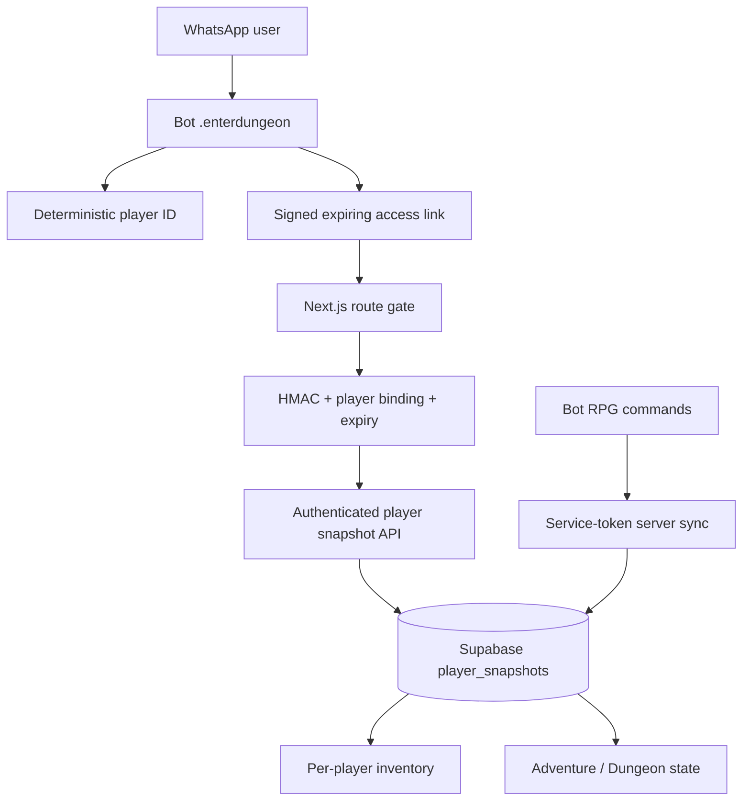

# WHISKAY RPG — Master Stage Archive (Stages 1–22)

**Updated:** 2026-10-29  
**Purpose:** canonical navigation and scope ledger. This document summarizes the historical stages without replacing or deleting their original setup reports. See `archive/` for duplicated snapshots imported from prior project bundles; those duplicates are retained intentionally for provenance.

> Status labels are deliberately conservative: **documented** means the scope exists in the archive; **code present** means corresponding source exists; **verified** means a local automated check passed in the current workspace; **production verified** requires live WhatsApp/Supabase/Vercel validation and is not implied by a source check.

## Stage register

| Stage | Scope | Primary historical record | Current interpretation |
|---:|---|---|---|
| 1 | Story lore UI, dungeon entry, first floor/story loop | `stages/STAGE-1-LORE-DUNGEON.md` | Foundation and story prototype; route auth is now enforced separately. |
| 2 | Player snapshot API and bot↔web sync | `stages/STAGE-2-PLAYER-SYNC-API.md` | Supabase `player_snapshots` is intended as persistent shared state; old unauthenticated reads were corrected in this update. |
| 3 | Bot synchronization plugin and player identity bridge | `stages/STAGE-2-PLAYER-SYNC-API.md`, bot `src/plugins/games/rpg-sync.js` | Player IDs are deterministically derived from WhatsApp chat/sender by the bot. |
| 4 | Quick-use potion, floor-5 elite boss/AoE | `stages/STAGE-4-BOSS-QUICK-USE.md` | Combat UI and boss mechanics; server-authoritative damage/rewards remain a production-hardening area. |
| 5 | Daily reward and cooldown | `stages/STAGE-5-6-SETUP.md` | API/RPC-backed rewards; verify schema and deployment environment before release. |
| 6 | Shop and potion purchase | `stages/STAGE-5-6-SETUP.md` | Economy endpoints exist; mutation requests must be authenticated and user-bound. |
| 7 | Bot downloader/interactive media selection | Bot archive `archive/bot/docs/STAGE-7-DOWNLOADER.md` | YouTube path fixed for Baileys send API and more robust MP4 format fallback; unit tests added. |
| 8 | RPG API and UI verification milestone | `scripts/verify-stage8.mjs` | Automated structural check; not a live integration test. |
| 9 | Economy, gacha, crafting/trading foundations | `stages/STAGE-9-10-SETUP.md`, bot `docs/archive/bot/docs/STAGE-9-ECONOMY.md` | Keep inventory and Gold server-sourced; atomic SQL RPCs are preferred for transactions. |
| 10 | Adventure/world connection and bot commands | `stages/STAGE-9-10-SETUP.md`, `stages/OPEN-WORLD-ACTION-UPDATE.md` | Browser game features must not bypass signed access gates. |
| 11 | Day/night cycle and weather | `stages/STAGE-11-SETUP.md` | Visual environment systems; client effects are prototypes unless server validated. |
| 12 | Resource gathering/destructible objects | `stages/STAGE-12-13-SETUP.md` | Gathering and materials should be tied to player snapshot, not shared local demo state. |
| 13 | Mini-games/interactions and world props | `stages/STAGE-12-13-SETUP.md` | Documented gameplay extension; verify runtime asset availability. |
| 14 | Next-gen visual effects and autonomous energy worker (bot archive) | `archive/bot/docs/stage14/STAGE-14-SETUP.md`, `docs/stage14/IMPLEMENTATION-REPORT.md` | Rendering/worker features with device/runtime constraints. |
| 15 | Further web systems and persistence integration | `docs/stage15/SETUP.md`, `docs/stage15/IMPLEMENTATION-REPORT.md` | Source and report retained; run stage-specific script before release. |
| 16 | Combat/guild/AI memory | Web `STAGE-16-COMBAT-GUILD.md`; bot `STAGE-16-GUILD-AI-MEMORY.md` | Guild functions are server/RPC-oriented; “AI memory” is software state, not evidence of consciousness. |
| 17 | Audit/consistency pass | `STAGE-17-AUDIT.md` | Audit record; see test matrix for current checks. |
| 18 | Global auction, mounts, storm rules, world boss | `STAGE-18-AUDIT.md` | Auction uses SQL RPCs; mounts/weather include client-side prototype elements. |
| 19 | Menu/card/energy audit (bot) and project audit | `STAGE-19-AUDIT.md` | Preserve audit details and limitations; bot menu renderer has cross-client caveats. |
| 20 | Virtual pet, companion, Canvas mini-games/group safety | Bot `STAGE-20-MILESTONE.md`; web `STAGE-20-MILESTONE.md` | Pet state is stored in snapshots; verify credentials and RPC behavior in deployment. |
| 21 | Auto tunnel / runtime webhook manifest | `STAGE-21-AUTOTUNNEL.md` | Manifest must contain public endpoint metadata only; webhook secrets remain server-side. |
| 22 | Operations center, health checks, maintenance | `STAGE-22-OPS-CENTER.md` | Operational tooling; local verification does not prove production uptime. |
| 23+ | Future stages | New dated file required | Do not renumber or rewrite old records; append a new stage file and update both README indexes. |

## Current fixes (2026-10-29)

### Bot YouTube downloader

- Media is sent through the serialized Baileys socket: `ctx.sock.sendMessage(ctx.chat, content, { quoted: ctx.raw })`. The old `ctx.send(...)` call was invalid because the serializer context does not define `ctx.send`.
- MP4 selection now tries `bv*[height<=720]+ba/b[height<=720]/b`, followed by MP4 merge output. This permits separate video/audio streams and falls back when a single-file 720p MP4 is not offered.
- Errors are normalized to explain when the requested format is unavailable. Private, login-gated, or inaccessible content remains unsupported.
- Automated unit tests exercise format fallback and socket media delivery. They do not call YouTube or download actual media.

### Web access and inventory isolation

- `/adventure`, `/dungeon`, and `/inventory` require a signed, unexpired access token bound to a 32-character player ID.
- The landing page shows a WhatsApp verification modal. The user sends `.enterdungeon` to the configured bot, then opens the bot-issued temporary link to return to the website.
- First valid player snapshot read creates a server-side player row if none exists. Every character gets an isolated `player_snapshots.player_id` row.
- `/api/player` now requires both `player` and `accessToken`; an arbitrary `?player=` no longer returns private inventory.
- Inventory UI renders only server snapshot items. Demo items and localStorage inventory fallbacks were removed. Legacy static HTML entry points were removed to prevent route shadowing.
- Game dungeon entry passes the validated player ID/token into the client, and reads/writes the snapshot with the same signed credentials.

## Canonical state model



## Required checks before release

Bot project:

```bash
npm test
node --check src/plugins/tools/youtube.js
```

Web project:

```bash
npm run verify:whatsapp-inventory
npm run verify:all
npm run build
```

Production verification must additionally test an invalid/no-token visit, a valid bot-issued link, two separate WhatsApp accounts with different inventories, token expiry, Supabase outage behavior, and mobile/desktop WhatsApp return navigation. Never record live tokens or phone numbers in test reports.

## History-preservation contract

- Existing stage files and `docs/archive/**` are historical records. Do not delete them to “clean up” the index.
- If a claim is superseded, add a dated correction note rather than silently rewriting the earlier statement.
- Root `README.md`, `docs/README.md`, `CHANGELOG.md`, this stage register, and a dated test report must be updated on every meaningful release.
